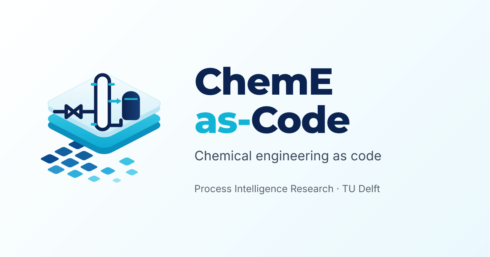
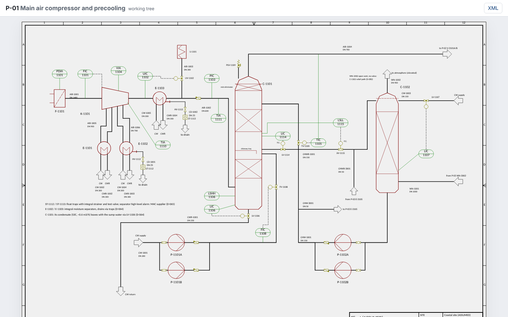

# ChemE-as-Code by [](https://www.pi-research.org/)

<p align="center">
  <a href="https://cheme-as-code.org"></a>
</p>

<p align="center">
  <a href="https://cheme-as-code.org"></a>
  <a href="https://atlas.cheme-as-code.org"></a>
  <a href="https://docs.cheme-as-code.org"></a>
  <a href="LICENSE"></a>
  
  
  <br>
  <a href="https://github.com/ChemE-as-Code/core/actions/workflows/ci.yml"></a>
  <a href="https://github.com/ChemE-as-Code/core/actions/workflows/viewer.yml"></a>
</p>

## Overview

ChemE-as-Code (chemical engineering as code) keeps a chemical plant design as plain files in a git
repository: P&IDs (piping and instrumentation diagrams) in the open DEXPI 2.0.1 format, engineering lists in YAML and design decisions in Markdown. Engineers
and AI coding agents edit the same files, and every change has a history, a review and a diff, as
in software development. The [home page](https://cheme-as-code.org) explains the idea in plain
language.

This repository holds the toolkit: the `cheme` command that checks, formats, draws and compares
those files; the **Viewer** ([`viewer/`](viewer/README.md)), a web app for browsing a plant
repository; and an **agent runner** ([`agent-cli/`](agent-cli/README.md)) that runs Claude agents
with a spending cap. The `cheme` package needs neither the Viewer nor an AI provider. This is
research software in active development: research output, not engineering advice.
The example designs in the [Process Atlas](https://atlas.cheme-as-code.org) were produced by AI
agents under human direction and are not approved for construction, operation or safety
decisions.

<p align="center">
  
</p>

## Features

- **Validate** P&IDs and engineering lists, and the lists against the P&IDs: each finding has a
  `file:line` location and a stable id that agents can act on (`cheme validate`).
- **Format, render and diff** DEXPI P&IDs: canonical XML for small diffs, SVG/PNG drawings and a
  visual diff between git revisions (`cheme fmt`, `cheme render`, `cheme diff`).
- **Process design**: block and process flow diagrams (BFD, PFD) from the flowsheet, stream tables with provenance, mass and
  energy balances, reactors and stream properties (`cheme process ...`).
- **Layout and assessment**: a 3D plant model, cable and lifting studies, material take-off,
  cost estimate, techno-economic analysis and life cycle assessment (`cheme layout`, `cheme assess`).
- **Engineering-step gates and sign-offs** per project stage, HAZOP (hazard and operability) studies and review records
  (`cheme check`, `cheme status`, `cheme safety hazop`).
- **Agent skills**: instructions for coding agents such as Claude Code, copied into each plant
  repository by `cheme init` and kept current with `cheme skills update`.
- **The Viewer**: P&IDs, streams, 3D layout, history and diffs of a plant repository, or of a
  whole library of plants; a web app that reads the API that `cheme serve` provides (see
  [viewer/README.md](viewer/README.md)).

## Quick start

Needs Python 3.12+ and [uv](https://docs.astral.sh/uv/). While the repositories are private, you
need read access to this repository and to
[pyDEXPI-dev](https://github.com/process-intelligence-research/pyDEXPI-dev) (pyDEXPI 2.x, not yet on PyPI).

```sh
uv tool install 'cheme-as-code[serve] @ git+https://github.com/ChemE-as-Code/core.git'
cheme init my-plant --name "My plant"   # a new plant repository
cd my-plant && cheme validate           # check its files
cheme serve                             # the read-only API the Viewer reads
```

To open the Viewer on it, see [viewer/README.md](viewer/README.md). Other extras (PNG drawings,
stream properties and more): see the [install section](REFERENCE.md#install).

## Documentation

- [Technical documentation](https://docs.cheme-as-code.org) (and the [Viewer docs](https://docs.cheme-as-code.org/viewer/))
- Plain-language pages: [toolkit](https://cheme-as-code.org/toolkit/),
  [Viewer](https://cheme-as-code.org/viewer/), [code and docs](https://cheme-as-code.org/code/)
- [REFERENCE.md](REFERENCE.md): the full reference (every command, file and endpoint)
- [viewer/README.md](viewer/README.md) and [agent-cli/README.md](agent-cli/README.md)
- Worked plants: the [Process Atlas](https://atlas.cheme-as-code.org)

## Citation

The papers are in preparation (working titles). Please cite ChemE-as-Code as below, and the
Process Atlas where you use its processes. See also [cheme-as-code.org/about/cite](https://cheme-as-code.org/about/cite/).

```bibtex
@misc{schweidtmann_cheme_as_code,
  author = {Schweidtmann, Artur M.},
  title  = {{ChemE-as-Code}: An Open-Source Platform for {AI}-Accelerated Chemical Process Engineering},
  url    = {https://cheme-as-code.org},
  year   = {2026},
  note   = {in preparation}
}

@misc{schweidtmann_process_atlas,
  author = {Schweidtmann, Artur M. and Weber, Jana M.},
  title  = {Process Atlas: an open, git-native, reproducible library and life cycle inventory of chemical processes},
  url    = {https://atlas.cheme-as-code.org},
  year   = {2026},
  note   = {in preparation}
}
```

## Contributors

| | Name | Role |
|---|---|---|
|  | [Artur M. Schweidtmann](https://www.pi-research.org/author/artur-schweidtmann/) ([LinkedIn](https://www.linkedin.com/in/schweidtmann/))<br>Process Intelligence Research, Department of Chemical Engineering, Delft University of Technology | ChemE-as-Code and Process Atlas (principal investigator) |
|  | [Achmad A. Alimin (Angga)](https://www.pi-research.org/people/achmad-a-alimin/) | Safety and HAZOP; layout STL export |
|  | [Sophia Rupprecht](https://www.pi-research.org/people/sophia-rupprecht/) | Inherited thermodynamic model selection, phase calculations, units and skills; design case study |
|  | [Elise](https://github.com/evanvoorbergen) | Inherited reaction identification, kinetics retrieval, filtering and unit conversion |

Everyone who contributes is credited in the git history: see the
[contributors of this repository](https://github.com/ChemE-as-Code/core/graphs/contributors).

## License

This repository (the `cheme` toolkit, the Viewer in `viewer/` and the agent runner in `agent-cli/`)
is licensed under the GNU Affero General Public License v3.0 or later (AGPL-3.0-or-later); see
[LICENSE](LICENSE) and [NOTICE](NOTICE). Bundled third-party data keeps its own terms, recorded
next to it ([details](REFERENCE.md#license)). Copyright (C) 2026 Artur Schweidtmann; TU Delft
disclaims copyright interest.

The skills and scripts `cheme init` copies into a plant repository stay AGPL-3.0-or-later. Your plant
data and models (P&IDs, YAML, reports, generated drawings and results) are yours, under terms you
choose: running the tools does not put AGPL on what they produce.

## Contact

Artur Schweidtmann, [a.schweidtmann@tudelft.nl](mailto:a.schweidtmann@tudelft.nl). For working
with industry, see the [ways to collaborate](https://www.pi-research.org/industry/) and the
[contact page](https://cheme-as-code.org/about/#contact). Developed by the
[Process Intelligence Research group](https://www.pi-research.org), Delft University of Technology.
