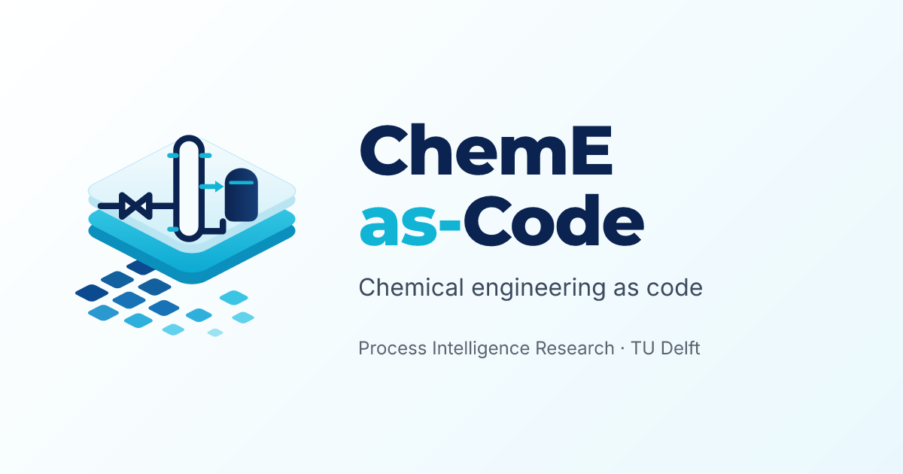
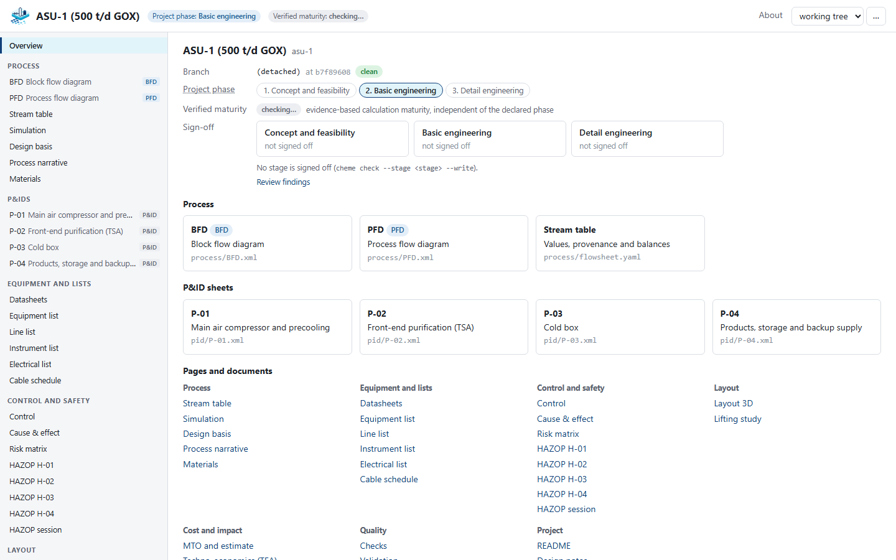
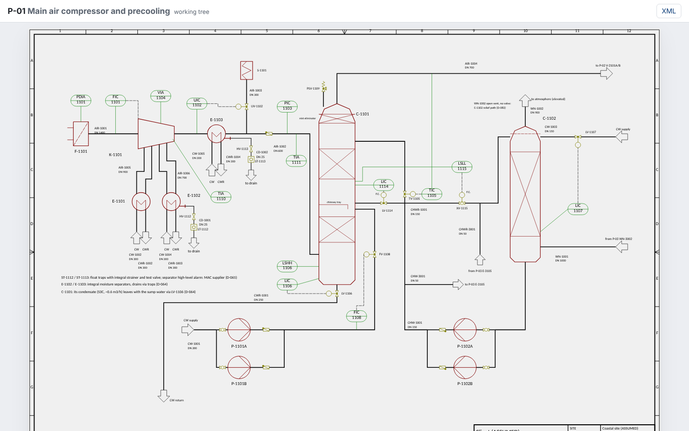

# ChemE-as-Code Viewer by [](https://www.pi-research.org/)

<p align="center">
  <a href="https://cheme-as-code.org"></a>
</p>

<p align="center">
  <a href="https://cheme-as-code.org"></a>
  <a href="https://atlas.cheme-as-code.org"></a>
  <a href="https://docs.cheme-as-code.org/viewer/"></a>
  <a href="LICENSE"></a>
  
  <a href="https://github.com/ChemE-as-Code/core/actions/workflows/viewer.yml"></a>
  
</p>

## Overview

ChemE-as-Code keeps a chemical plant design as plain files in git: P&IDs in DEXPI 2.0.1 (the
open exchange format for P&IDs), YAML lists and Markdown documents. The Viewer opens one such engineering project in the browser and shows it
the way an engineer reads it: drawings, lists, stream tables, checks and the history of every
change. It is read-only; editing stays with people and AI agents working on the files.

It runs against `cheme serve` (one plant, or a whole library of plants), or on a static snapshot
with no server at all. The [Process Atlas](https://atlas.cheme-as-code.org) embeds it on every
process page. A plain-language introduction is on the home page:
[cheme-as-code.org/viewer](https://cheme-as-code.org/viewer/).

<p align="center">
  
  
</p>

## Features

- **P&IDs** rendered to SVG on the server: pan, zoom, click or keyboard to inspect an object,
  deep links to a tag (`?select=LIA-4107`).
- **Diffs between revisions**, side by side or overlaid, coloured as `cheme diff` colours them, with
  a change table.
- **Lists and documents**: equipment, line and instrument lists as tables built from their JSON
  Schema; design basis, HAZOP studies, Markdown and CSV files readable.
- **Process data**: stream table with provenance (given, assumed or
  calculated) and balances, the recorded simulation run,
  reactions, kinetics and catalysts.
- **Quality and decisions**: checks, validation findings, reviews and sign-offs, maturity (how far the
  calculations are backed by evidence), cost estimate, techno-economics, life cycle assessment, control and cause & effect.
- **3D layout** of the plant with a material take-off.
- **Library mode**: one server for many plants, with a filterable index of them.
- **Static snapshots and embedding**: one revision as files on any static host, framed in another
  page with `?embed=1`.

## Quick start

Requires Node.js 22 (22.22.2 or later), 24 (24.15 or later) or 26+, and the `cheme` toolkit
installed with its `serve` extra (see the [root README](../README.md#quick-start)).

```sh
cd viewer
npm ci && npm run build                                  # type-checks, writes dist/
cheme serve --repo path/to/my-plant --ui dist            # one plant at http://127.0.0.1:8765
cheme serve --repo path/to/process-library --ui dist     # library mode: each plant under /p/<id>/
```

For a static snapshot (`npm run build:static`, `cheme export-static`), the dev server and the
tests, see [REFERENCE.md](REFERENCE.md#static-snapshot-no-server).

## Documentation

- Viewer documentation: [docs.cheme-as-code.org/viewer](https://docs.cheme-as-code.org/viewer/)
- Technical documentation of ChemE-as-Code: [docs.cheme-as-code.org](https://docs.cheme-as-code.org)
- Plain-language pages: [cheme-as-code.org](https://cheme-as-code.org) (the
  [Viewer](https://cheme-as-code.org/viewer/), the [toolkit](https://cheme-as-code.org/toolkit/),
  [Code & Docs](https://cheme-as-code.org/code/))
- Full reference in this folder: [REFERENCE.md](REFERENCE.md): every [page and route](REFERENCE.md#pages),
  [serving](REFERENCE.md#serve) and [library mode](REFERENCE.md#several-plants-a-library),
  [static snapshots](REFERENCE.md#static-snapshot-no-server), [embedding](REFERENCE.md#embedding),
  [development](REFERENCE.md#develop) and [design notes](REFERENCE.md#design-notes)
- Architecture decisions: [docs/adr/](docs/adr/README.md)

## Citation

The paper is in preparation (working title). Until it appears, please cite:

```bibtex
@misc{schweidtmann_cheme_as_code,
  author = {Schweidtmann, Artur M.},
  title  = {{ChemE-as-Code}: An Open-Source Platform for {AI}-Accelerated Chemical Process Engineering},
  url    = {https://cheme-as-code.org},
  note   = {in preparation}
}
```

How to cite ChemE-as-Code and the Process Atlas: [cheme-as-code.org/about/cite](https://cheme-as-code.org/about/cite/).

## Contributors

| | Name | Role |
| --- | --- | --- |
|  | [Artur M. Schweidtmann](https://www.pi-research.org/author/artur-schweidtmann/) ([LinkedIn](https://www.linkedin.com/in/schweidtmann/)) | ChemE-as-Code (principal investigator); Process Intelligence Research, Department of Chemical Engineering, Delft University of Technology |

Everyone who contributes is credited in the git history: see the
[contributors of this repository](https://github.com/ChemE-as-Code/core/graphs/contributors).

## License

The Viewer is free software under the GNU Affero General Public License v3.0 or later
(AGPL-3.0-or-later); see [LICENSE](LICENSE). Copyright (C) 2026 Artur Schweidtmann; TU Delft
disclaims copyright interest (see [NOTICE](NOTICE)). Plant repositories shown in the Viewer keep
their own licences.

This is research software in active development by the
[Process Intelligence Research group](https://www.pi-research.org), Delft University of Technology.
It is research output, not engineering advice.

## Contact

Questions, or working with us as a company: Artur Schweidtmann,
[a.schweidtmann@tudelft.nl](mailto:a.schweidtmann@tudelft.nl). Ways to collaborate:
[pi-research.org/industry](https://www.pi-research.org/industry/); see also
[cheme-as-code.org/about](https://cheme-as-code.org/about/#contact).
